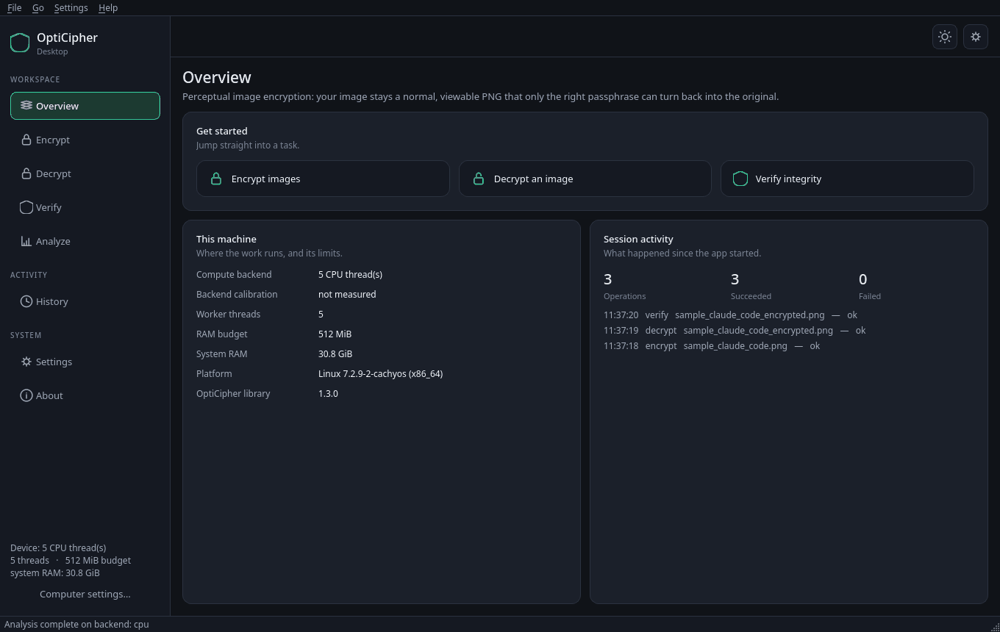
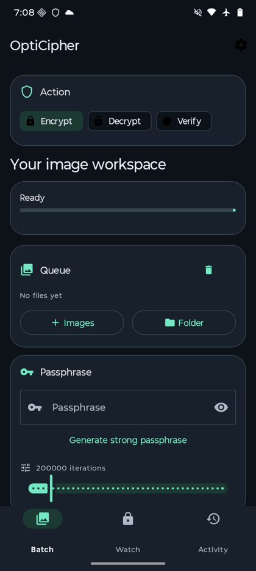

# OptiCipher

### Your images, transformed into authenticated PNGs.

OptiCipher is an open-source image-encryption research project for **desktop, Android and the web**. Encrypt a picture into a viewable noise-like PNG, verify it has not been modified, and restore its pixels with the passphrase. Processing happens on your device; the image and passphrase are not uploaded by the encryption workflow.

> **Research and education software, not an audited vault.** Do not rely on this as the sole protection for sensitive data. PBKDF2 is memory-cheap, and image statistics are not proof of security. See [security](#security-and-limitations).

[Get desktop & Android releases](https://github.com/j1seki/OptiCipher-Desktop/releases) · [Technical reference](docs/REFERENCE.md) · [Format specification](docs/FORMAT.md) · [Web & Android notes](docs/WEB_ANDROID.md)

## Meet OptiCipher

| | Desktop | Android APK | Web |
|---|---|---|---|
| **Encrypt / decrypt** | Batch, previews, private storage and optional SFTP copy | Batch, previews, private storage, sharing and optional SFTP copy | Locally in the browser |
| **Verify** | Batch format and integrity checks | Batch format and integrity checks | Authenticate or inspect format |
| **Analyze** | Entropy, correlation, NPCR/UACI and histograms | Entropy, correlation, NPCR/UACI and histograms | Image statistics |
| **Folder watch** | Independent schedules while the desktop app is open | Independent schedules through Android background work | — |
| **Run** | Linux, macOS, Windows | Native Kotlin app | Static site, no server required |

Ciphertexts use the same v1 format across editions. Save and transfer encrypted images as **lossless PNG**; lossy conversion destroys the ciphertext.

### See it in action

Screenshot slideshows, not recordings of live interactions:

| Desktop | Android APK |
|---|---|
|  |  |

## Get started

### Desktop

Download the appropriate package from [Releases](https://github.com/j1seki/OptiCipher-Desktop/releases), or run from source with Python 3.9+:

```bash
git clone https://github.com/j1seki/OptiCipher-Desktop.git
cd OptiCipher-Desktop
python -m venv .venv
source .venv/bin/activate  # Windows: .venv\Scripts\activate
pip install -e ".[app]"
python -m app.main
```

On Debian and Ubuntu, Qt's X11 backend needs `libxcb-cursor0`, `libxcb-icccm4`, `libxcb-keysyms1`, and `libxcb-shape0`.

Choose **Encrypt**, add images, enter and confirm a passphrase, select an output destination and start. **Generate strong passphrase** fills both fields. Use **Decrypt** with the same passphrase to restore pixels. **Use private folder** saves results under your user application data. SFTP destinations keep a local result and send a copy to a server trusted in your SSH `known_hosts` file.

In **Folder watch**, configure separate encrypt and decrypt inboxes, interval or weekly checks, and the output conflict policy. The desktop scheduler runs while OptiCipher is open, including when minimized. When you opt in to remembering a watch passphrase, the app uses the system credential store. History can keep recent filenames and outcomes across launches if you enable it. **About → Check for updates** opens official release downloads when a newer version is available. Desktop exposes CPU and WebGPU controls in Settings.

On desktop and Android, **Logs** provides a scrollable event log with wrap and timestamp controls plus clipboard export. The separate **Job history** screen shows completed batch operations and folder scans with their per-file results. Open a job to copy its results or confirm your review. Desktop retains logs and job history across launches when you enable local persistence on the Job history screen.

### Android

Install `OptiCipher-android.apk` from [Releases](https://github.com/j1seki/OptiCipher-Desktop/releases). In **Batch**, choose Encrypt, Decrypt, Verify or Analyze, then start the selected action from the queue. Verify shows each image's format, authentication result and file hash. Analyze shows the histogram, entropy and correlation of the first image, plus NPCR and UACI for a comparable second image. Change the theme under **Settings → Appearance**.

For an SFTP copy, choose **Configure SFTP copy** under Batch output. Enter the SFTP URL and paste the server's public host key from a trusted source. Authenticate with a password or a selected SSH private key. Each result is saved locally first. The transfer settings live in the current app session.

**Folder watch** configures independent encrypt and decrypt inboxes using Android's system folder picker.

Folder watches offer recurring checks every **15 minutes, 1 hour, 6 hours, 12 hours or daily**, or a **weekly weekday and time**, plus **Run now** to queue a check while the watch is enabled. Interval watches queue an initial check. Weekly watches use the device's local time and wait for their scheduled time unless you choose Run now. Android can delay background work. Background watches require the separate remembered watch passphrase, stored using Android Keystore-backed encrypted preferences. Choose **Skip** or **Overwrite** for output conflicts. Overwriting in a picked folder requires a provider that supports renaming files.

Progress is reported per file in the app and notifications; a large image has no finer-grained progress indicator. Passphrase fields include an optional secure random generator; save generated passphrases somewhere safe.

**Optional private folder:** enable **Save to private folder** for batch outputs, or choose **OptiCipher private** in Android's system Files picker as an input or output folder, including for folder watches. The provider uses internal app storage and supports directories. Other apps can access items you explicitly grant through the picker; shared copies are no longer private. Like the storage concept in [Aer](https://github.com/nain-F49FF806/anemo-aer), this is separate app storage, but it does **not** implement Aer's lock, auto-lock, or secondary storage options. It is not an encrypted or password-locked vault and does not protect originals, exports, compromised devices, or privileged access. Files are excluded from backup and **deleted when the app is uninstalled**; export them first.

To build an APK:

```bash
cd android
./gradlew assembleDebug
# app/build/outputs/apk/debug/app-debug.apk
```

### Web

Build the static site locally:

```bash
cd web
npm ci
npm run build
python3 -m http.server --bind 127.0.0.1 --directory dist 8000
```

Open `http://127.0.0.1:8000`. A hosted copy needs HTTPS for Web Crypto.

## How it works

1. PBKDF2-HMAC-SHA256 derives keys from the passphrase and a fresh per-image salt.
2. A keyed pixel permutation scrambles positions; ChaCha20 diffuses pixel values.
3. HMAC-SHA256 authenticates the header and ciphertext. Metadata and the tag are embedded in an extra strip of the PNG.
4. Decryption checks the tag before restoring pixels; a wrong passphrase or modification is rejected.

The result is **pixel-exact**, not necessarily the original file bytes: decoded image pixels are restored to a new PNG, not original metadata, encoding or file structure. The desktop CPU and optional WebGPU implementations target the same reference bytes. See [algorithm](docs/ALGORITHM.md), [format](docs/FORMAT.md), [image support](docs/IMAGE_FORMAT_SUPPORT.md), and [benchmarks](docs/BENCHMARKS.md).

### CLI and library

```bash
pip install -e .
opticipher encrypt input.png encrypted.png  # prompts for passphrase
opticipher decrypt encrypted.png restored.png
opticipher metrics encrypted.png
```

The Python API exposes `load_image`, `encrypt_image`, `decrypt_image` and `save_image`. For code examples, metrics, research background and the detailed threat model, see the [technical reference](docs/REFERENCE.md).

## Security and limitations

- This is a research implementation and has **not received an independent cryptographic audit**. Use established, audited encryption for high-value or safety-critical secrets.
- PBKDF2 is not memory-hard; use a strong, unique passphrase. Anyone holding a ciphertext can attempt offline guesses.
- HMAC detects modifications and incorrect passphrases; noise-like appearance and image metrics alone do not establish security.
- Original inputs, previews, shared outputs, OS backups and recipient copies may remain outside the protection of the private folder. Android private files are deleted on uninstall.
- Some Android and web image decoders may alter semi-transparent pixels; see [image support](docs/IMAGE_FORMAT_SUPPORT.md). Encryption is not intended to preserve EXIF/ICC or other file metadata.

## Development

```bash
pip install -e ".[app,dev]"
pytest
cd web && npm ci && npm test
cd ../android && ./gradlew testDebugUnitTest
```

The Python library lives in `opticipher/`, the PySide6 desktop app in `app/`, the browser edition in `web/`, and the native Android app in `android/`. See [CONTRIBUTING.md](CONTRIBUTING.md) and the [technical reference](docs/REFERENCE.md).

## License and attribution

MIT licensed. OptiCipher originates with [bio-colab/OptiCipher](https://github.com/bio-colab/OptiCipher); this fork adds desktop, web and Android editions. See [LICENSE](LICENSE).
