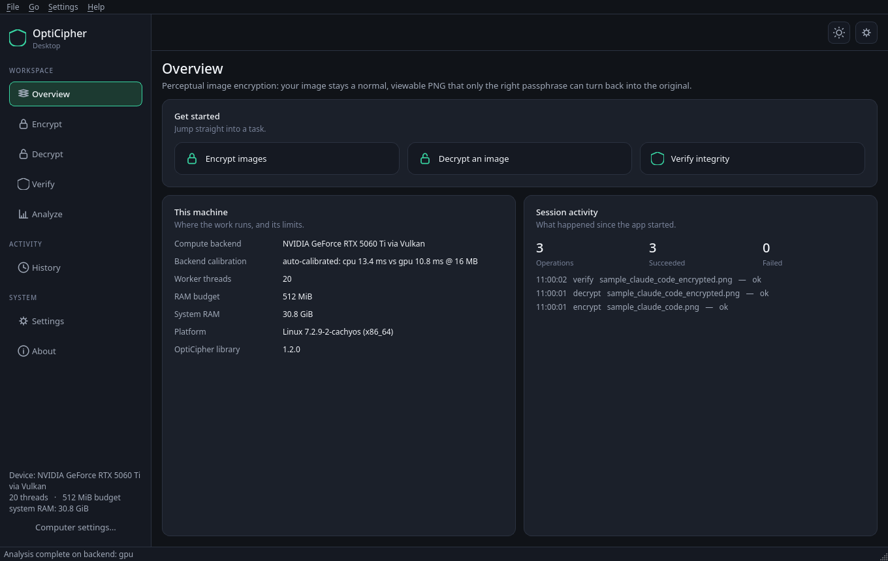
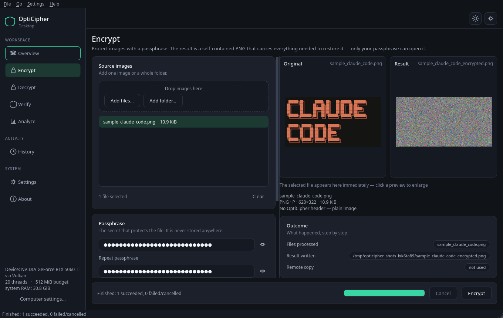
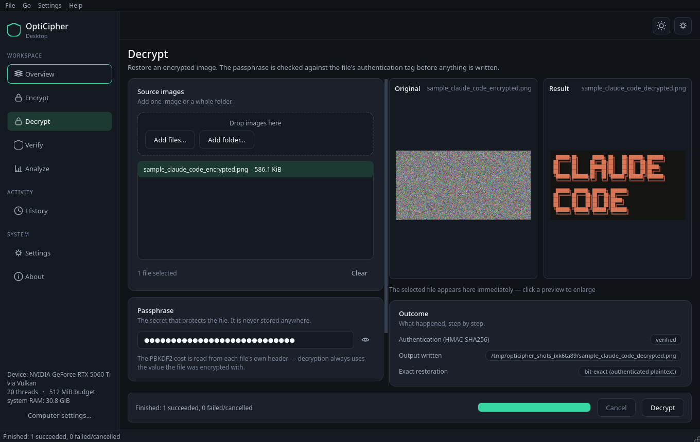
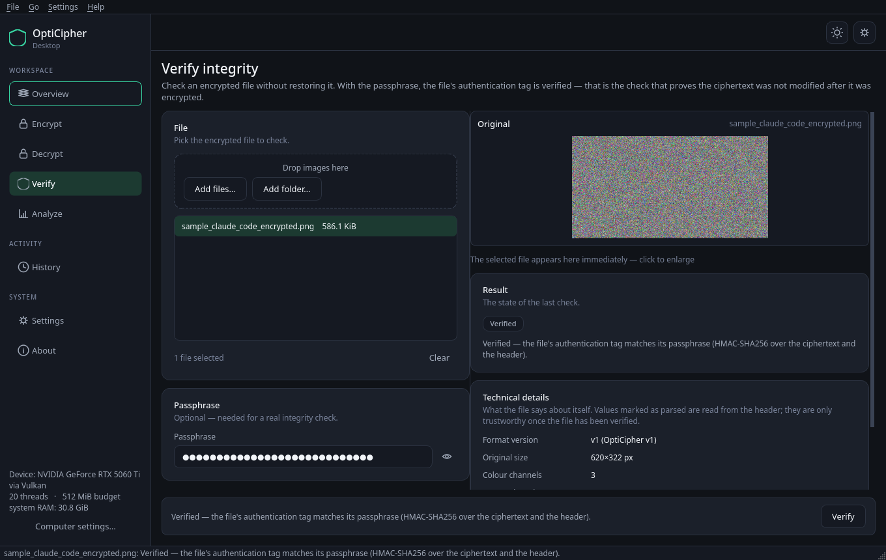
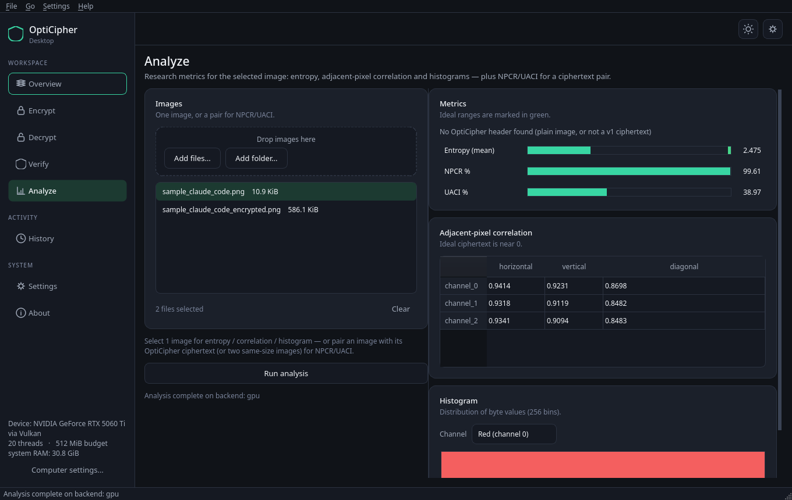
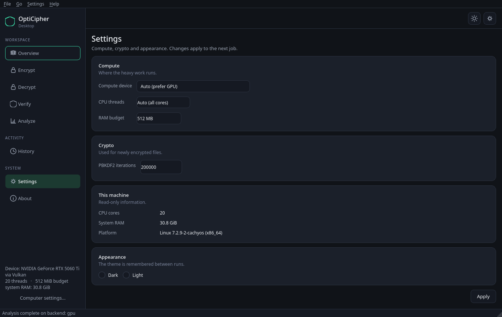

# OptiCipher

> **This repository is the OptiCipher Desktop fork** — a cross-platform desktop
> app and hardware-accelerated build of [bio-colab/OptiCipher](https://github.com/bio-colab/OptiCipher)
> (MIT). The encryption algorithm, file format and CLI are unchanged: encrypted
> PNGs are **bit-for-bit interchangeable** with the original tool in both
> directions, proven by a test suite that pins every compute backend to the
> reference bytes. See [OptiCipher Desktop](#opticipher-desktop-this-fork) below.

**Open-source optical (perceptual) image encryption — for research and education.**

OptiCipher turns an image into a real, viewable PNG that *looks* like pure noise,
yet still contains every bit of the original. Pixels are spatially **scrambled**
and their colour values are **diffused** with a stream cipher. Everything needed
to decrypt (except your passphrase) is embedded **inside the image itself**, so a
single PNG is fully self-contained. Decryption is **bit-exact**: you get back the
original image, pixel for pixel.

> **Status:** research / educational reference implementation. Read
> [Threat model & security notes](#threat-model--security-notes) before using it
> to protect anything that genuinely matters.

---

## OptiCipher Desktop (this fork)

A PySide6 desktop app over the same library, with pluggable hardware
acceleration and per-OS installers.

### Screenshots

Real captures from the running app (regenerate with
`python packaging/screenshots.py`).

**Overview** — the home screen: quick actions, what this machine can do, and
what has happened in this session:



**Encrypt** — sample loaded, encryption finished, before/after preview and
the KDF cost control:



**Decrypt** — a real decryption, reported step by step (authentication tag
verified → output written → exact restoration) instead of one blanket
"success":



**Verify integrity** — the authentication check for a ciphertext, with the
technical details it was based on:



**Analyze** — entropy, adjacent-pixel correlation, NPCR/UACI and the
per-channel histogram for an original/ciphertext pair:



**Settings** — compute device, threads, RAM budget, PBKDF2 cost, theme, and
what this machine offers:



### The interface

The application is a sidebar shell around eight real screens — no
placeholder pages, and no feature that is only a label:

| Screen | What it does |
|---|---|
| **Overview** | quick actions, the live compute backend and its limits, and the session's activity |
| **Encrypt** | batch encrypt with drag-and-drop, passphrase + confirmation, KDF cost, destination, live preview |
| **Decrypt** | the same shape, plus a step-by-step outcome (authentication → write → exact restoration) |
| **Verify** | read-only integrity check of a ciphertext, with the verdict and the technical details behind it |
| **Analyze** | entropy, H/V/D adjacent correlation, NPCR/UACI, 256-bin per-channel histograms |
| **History** | what happened in this session — in memory only, never written to disk |
| **Settings** | compute device, threads, RAM budget, PBKDF2 cost, theme |
| **About** | version, provenance, and the honest limits of the tool |

Design system notes:

- **One token set, two themes.** Every colour, radius and spacing value
  lives in `app/theme.py`; the dark theme is the default and a light theme
  is one palette away. The choice is remembered between runs.
- **No inline stylesheets.** Components declare a *role* (an `objectName`)
  and the generated stylesheet styles that role, so a component restyles
  everywhere at once.
- **No icon dependency.** The ~30 glyphs are drawn with `QPainter`
  (`app/icons.py`) — crisp at any DPI, recoloured per theme, nothing extra
  to vendor into the packaged build.
- **Keyboard reachable.** `Alt+1`…`Alt+8` switch screens, every control has
  an accessible name, and every control has a tooltip.
- **Honest state.** A decryption only claims success when the
  authentication tag verified *and* the output was written *and* the
  restoration was exact — three separate rows. Verification without a
  passphrase says "not authenticated" rather than "verified".

### What the desktop app adds

| Feature | Details |
|---|---|
| **Encrypt / Decrypt / Verify / Analyze** | drag-and-drop, batch queues, before/after preview |
| **Metrics dashboard** | entropy, H/V/D adjacent correlation, NPCR/UACI, 256-bin histograms |
| **Read-only integrity check** | verifies a ciphertext's HMAC-SHA256 tag without restoring it, and distinguishes "wrong passphrase or modified", "malformed", "unsupported format" and "not authenticated" |
| **Compute device picker** | Auto / GPU / CPU, CPU thread count, RAM budget — Auto runs a one-time per-machine calibration and picks the faster backend |
| **KDF cost slider** | PBKDF2 iterations (the format-legal cost knob; higher = slower brute-force, slower encrypt) |
| **Background jobs** | every job runs on a worker thread with progress + cancel; the UI never blocks |
| **Device info panel** | shows the exact GPU adapter and API in use (Metal / Vulkan / DX12) |
| **SFTP output locations** | type `sftp://user@host[:port]/path` in the Output field and every result is also uploaded there as a size-verified copy; passwords are asked once per session and never saved to disk |
| **Safe writes** | outputs are written atomically (temp → fsync → rename) and never overwrite an existing file — a numbered name (`_2`) is chosen instead; batch failures surface as one summary dialog, not one per file |
| **Dark & light themes** | one token set, two palettes, remembered between runs; no white flash when switching |
| **Session history** | a short, in-memory log of what you did — deliberately not persisted |

### Hardware acceleration, without breaking the format

`opticipher/accel/` adds compute backends under the unchanged public API:

- **CPU backend** — multi-core ChaCha20 (band-split with exact counter-seek so
  the keystream is *identical* to the single-context reference) and RAM-budget
  band sizing.
- **GPU backend** — WebGPU via `wgpu` (WGSL compute shaders): Metal on macOS
  (incl. Apple Silicon), Vulkan on Linux, DX12/Vulkan on Windows. ChaCha20
  full blocks on the GPU, tail via the reference cipher; histogram / NPCR /
  UACI kernels for the Analyze tab. No CUDA toolkit needed — `wgpu` ships its
  own native binaries in its wheels.
- **Automatic CPU fallback** — no GPU, no Vulkan, or a driver problem? Every
  job still runs, on the CPU backend, with the reason shown in the UI.

**The hard rule, enforced by tests:** every backend must produce
byte-identical output to the upstream reference implementation.
`tests/test_accel.py` + `tests/test_gpu_accel.py` pin the keystream against
OpenSSL golden vectors across block boundaries and sizes — any single-byte
drift fails CI before it can touch a user's file. Measured numbers and their
honest interpretation live in [docs/BENCHMARKS.md](docs/BENCHMARKS.md).

### Integrity & file-safety guarantees

The reliability audit (phases 1–13) turned every promise into an executable
test. The full, normative specification — header layout, authenticated
regions, reader obligations, error semantics, the format-compatibility
matrix and a golden test vector that pins the v1 ciphertext bytes — is
[docs/FORMAT.md](docs/FORMAT.md). The headline rules:

- **Encrypt-then-MAC, verified before output.** HMAC-SHA256 covers every
  header field and every payload byte; decryption refuses to produce pixels
  that failed the check, and a wrong passphrase and a tampered file are
  deliberately indistinguishable (no password oracle).
- **No unbounded pre-auth work.** A crafted header cannot force hours of
  PBKDF2: iteration counts, dimensions and strip geometry are bounds-checked
  *before* key derivation (`tests/test_corruption.py`).
- **Pixel-exact, not byte-exact.** Restored pixels equal the original
  decode; the restored *file* is a fresh PNG (EXIF/ICC/palette are not
  preserved — `tests/test_compat_matrix.py` pins this per format, including
  that a JPEG re-encode of ciphertext is **detected**, never silently
  accepted).
- **Atomic, non-destructive saves.** Temp file → fsync → rename; existing
  files are never clobbered; a failed save leaves the previous file intact
  and no partial output (`tests/test_file_safety.py`).

### Installation (desktop app)

**Option A — download a release build (no Python required).**

Grab the artifact for your OS from
[Releases](https://github.com/j1seki/OptiCipher-Desktop/releases):

| OS | Artifact | Notes |
|---|---|---|
| **Linux** | `OptiCipherDesktop-linux-x64.tar.gz` or `.AppImage` | tar.gz needs the distro's usual GL/glib runtime libraries (table below); the AppImage is self-contained (needs FUSE, or run `./…AppImage --appimage-extract`) |
| **macOS** (Apple Silicon) | `…-macos-arm64.dmg` | unsigned build — right-click the app → **Open** on first launch to bypass Gatekeeper |
| **Windows** | `…-windows-x64.zip` | unzip and run `OptiCipherDesktop.exe` |

Linux: builds are produced on **Ubuntu 22.04 (glibc 2.35)**, so they start on
every current distribution — Arch/CachyOS, Debian 12+, Ubuntu 22.04+, Fedora,
and derivatives. The GUI needs the standard desktop runtime libraries:

| Distro | Install command |
|---|---|
| Debian / Ubuntu / Linux Mint | `sudo apt install libegl1 libgl1 libglib2.0-0 libxkbcommon0 libdbus-1-3 libfontconfig1` |
| Arch / CachyOS / Manjaro | `sudo pacman -S mesa libglvnd glib2 libxkbcommon dbus fontconfig` |
| Fedora | `sudo dnf install mesa-libEGL mesa-libGL glib2 libxkbcommon dbus-libs fontconfig` |

```bash
tar -xzf OptiCipherDesktop-linux-x64.tar.gz
./OptiCipherDesktop/OptiCipherDesktop
```

This is tested, not assumed: every CI push runs the packaged binary
headlessly in **Ubuntu 22.04 & 24.04, Debian 12 & 13, Arch and Fedora**
containers before the artifact is uploaded.

**Where releases come from:** pushing a version tag (`git tag v1.0.0 && git
push origin v1.0.0`) runs the full build + distro-test matrix and then
publishes everything as a [GitHub Release](https://github.com/j1seki/OptiCipher-Desktop/releases)
automatically. (The per-run *Actions artifacts* expire after 90 days — always
download from the Releases page.)

**Option B — install from source (Python 3.9+).**

```bash
git clone https://github.com/j1seki/OptiCipher-Desktop.git
cd OptiCipher-Desktop
python -m venv .venv && source .venv/bin/activate
pip install -e ".[app]"      # library + PySide6 + wgpu
python -m app.main           # launch the desktop app
```

Extras: `.[dev]` (tests), `.[gpu]` (wgpu only, no GUI), `.[app]` (GUI + wgpu).

**Option C — library & CLI only.**

```bash
pip install -e .
```

**Build the package yourself.**

```bash
pip install pyinstaller
pyinstaller packaging/opticipher-desktop.spec --noconfirm
./dist/OptiCipherDesktop/OptiCipherDesktop --smoke   # headless check
```

### How to use the desktop app

**Encrypt**

1. Open the **Encrypt** tab and add files or whole folders (*Add files…* /
   *Add folder…*, or drag-and-drop into the list).
2. Type a passphrase and repeat it in the confirmation box.
3. Optionally adjust the **KDF cost** slider — higher costs more to encrypt
   and far more to attack; 200,000 iterations is the default.
4. Optionally pick an **Output** folder; empty means "next to the input",
   writing `<name>_encrypted.png`. You can also type an SFTP location
   (`sftp://user@server.example.com/remote/dir`) — a login dialog asks for
   the password once per session (kept in memory only, never written to
   settings or disk), and each result is uploaded there as a verified copy
   while the local file is kept.
5. Press **Start**. The progress bar and the *before → after* preview update
   live; the status bar reports how many files succeeded.

**Decrypt**

1. Switch to **Decrypt** and add the encrypted PNGs.
2. Enter the passphrase (one box — decryption is verified, not guessed).
3. Press **Start** — the original is recovered next to the ciphertext as
   `<name>_decrypted.png`. A wrong passphrase or a tampered file is detected
   via HMAC and reported per file; you never get silent garbage.

**Analyze**

1. Go to the **Analyze** tab.
2. Add **one** image for entropy, adjacent-pixel correlation and the 256-bin
   histogram…
3. …or add an image **and its OptiCipher ciphertext** (the app aligns the
   reserved header strip automatically) to also get **NPCR** and **UACI**.
4. Press **Run analysis** — results render as metric bars, a correlation
   table and a selectable per-channel histogram; the status bar names the
   compute backend that ran it.

**Preview & info panel**

- The file selected in any tab shows in the **before** preview immediately —
  as soon as it is added, before any job runs — so you can confirm the right
  image was chosen.
- Below the previews, the **info panel** lists the file's name, format,
  colour mode, resolution, size, and whether it carries an OptiCipher
  ciphertext header (with the original dimensions, PBKDF2 cost and strip
  size stored in it).
- **Click any preview to enlarge** it in a scrollable full-size viewer
  (Esc closes).
- Every technical control (KDF cost, compute device, threads, RAM budget,
  PBKDF2 iterations) has a **tooltip** explaining what it does on hover.

**Settings & the device bar**

- *Settings → Compute device*: **Auto** (a one-time per-machine calibration
  picks the faster of CPU/GPU), **GPU** (WebGPU — Metal on macOS, Vulkan on
  Linux, DX12/Vulkan on Windows) or **CPU**; plus CPU thread count, RAM
  budget and the default PBKDF2 cost.
- The bottom **device bar** always shows what actually ran: adapter, API,
  threads, RAM budget and the calibration result.

All jobs run on background worker threads — the UI never blocks, and Cancel
stops a batch at the next file boundary.

### Attribution & license

MIT, unchanged from upstream — © [bio-colab](https://github.com/bio-colab)
(see [LICENSE](LICENSE)). This fork adds the `app/`, `opticipher/accel/` and
`packaging/` trees and keeps every upstream file's behaviour intact; the
original algorithm, CLI and docs below are theirs.

---

## Table of contents

- [OptiCipher Desktop (this fork)](#opticipher-desktop-this-fork)
  - [Screenshots](#screenshots)
  - [Installation (desktop app)](#installation-desktop-app)
  - [How to use the desktop app](#how-to-use-the-desktop-app)
- [What "optical encryption" means here](#what-optical-encryption-means-here)
- [Is this idea new?](#is-this-idea-new)
- [How it works (the algorithm)](#how-it-works-the-algorithm)
- [The self-contained header](#the-self-contained-header)
- [Project layout](#project-layout)
- [Installation](#installation)
- [Quick start](#quick-start)
- [Command-line usage](#command-line-usage)
- [Library usage](#library-usage)
- [Research metrics](#research-metrics)
- [Results on the bundled sample](#results-on-the-bundled-sample)
- [Threat model & security notes](#threat-model--security-notes)
- [Running the tests](#running-the-tests)
- [Benchmarking](#benchmarking)
- [Contributing](#contributing)
- [License](#license)

---

## What "optical encryption" means here

A normal cipher turns data into an opaque blob of bytes. OptiCipher instead keeps
the output as a **valid image**. The encrypted file is a PNG you can open in any
viewer; it simply shows visual noise. Two things are scrambled:

| Stage | What it hides | Effect |
|-------|---------------|--------|
| **Scramble** (permutation) | *where* each colour is | destroys shapes, edges, text |
| **Diffuse** (stream cipher) | *what* each colour is | flattens the histogram |

Together they remove both the spatial structure and the colour statistics of the
original, which is exactly what the standard "confusion + diffusion" principle of
cipher design asks for.

---

## Is this idea new?

**The building blocks are well established; the specific combination here is the
interesting part.** Image-encryption research dates back to the 1990s. You will
find extensive prior work on:

- **Pixel permutation / scrambling** — Arnold's Cat Map, chaotic maps, etc.
- **Value diffusion** — XOR with chaotic or cryptographic keystreams.
- **Visual / perceptual encryption** — keeping the ciphertext as an image.
- **LSB steganography and watermarking** — hiding data inside images.

What OptiCipher emphasises, and what is comparatively uncommon in one tidy
package, is being **fully self-contained and authenticated**:

1. A modern, audited stream cipher (**ChaCha20**) for diffusion rather than a
   home-rolled chaotic map.
2. A **size-agnostic keyed permutation** (Fisher–Yates) that works for any
   width × height — no square-image restriction like Arnold's Cat Map.
3. All decryption metadata (salt, iterations, dimensions) embedded **inside the
   image**, so there is no separate key file to manage.
4. **HMAC-SHA256 integrity**, so a wrong passphrase or any tampering is detected
   instead of silently producing garbage.

So: not a new primitive, but a clean, documented, reproducible synthesis that is
pleasant to study and to build on.

---

## How it works (the algorithm)

```
ENCRYPT
                          passphrase
                              │
                  ┌───────────▼───────────┐
   random salt ──►│  PBKDF2-HMAC-SHA256    │  (keys.py)
                  └───────────┬───────────┘
                              │  stream_key │ scramble_seed │ mac_key
  original ─► SCRAMBLE positions ─► DIFFUSE values ─► HMAC ─► append header strip
  (H×W×C)     (scramble.py)         (diffusion.py)   (core)   (stego.py)
                                                                  │
                                                                  ▼
                                                  self-contained ciphertext PNG
                                                       (H+strip rows × W × C)

DECRYPT
  ciphertext ─► read+parse header ─► re-derive keys ─► verify HMAC
                (stego/header)        (keys.py)         (core.py)
                              │ (fails fast on wrong passphrase / tampering)
                              ▼
             remove strip ─► UN-DIFFUSE ─► UN-SCRAMBLE ─► exact original
```

**Step by step:**

1. **Key derivation (`keys.py`).** Your passphrase plus a fresh random 16-byte
   salt are stretched by **PBKDF2-HMAC-SHA256** (default 200,000 iterations) into
   64 bytes, split into three role-specific sub-keys: a 32-byte stream key, a
   permutation seed, and a 16-byte MAC key. Same passphrase + salt ⇒ identical
   keys, which is what makes decryption possible.

2. **Scramble (`scramble.py`).** A keyed **Fisher–Yates** shuffle permutes pixel
   *positions* (colours travel with their pixel). It works for any image shape
   and is perfectly invertible.

3. **Diffuse (`diffusion.py`).** Every colour byte is XOR-ed with a **ChaCha20**
   keystream. Because each image gets a unique key (fresh salt), reusing a
   constant-derived nonce is safe. XOR is its own inverse, so the same routine
   encrypts and decrypts.

4. **Authenticate + embed (`core.py`, `header.py`, `stego.py`).** An
   **HMAC-SHA256** tag is computed over the header fields and the ciphertext
   ("encrypt-then-MAC"). The header is then written into a small **reserved
   strip** of extra pixel rows appended to the bottom of the image.

Decryption reverses everything and refuses to proceed unless the HMAC verifies.

---

## The self-contained header

Every encrypted image carries a 70-byte header in a thin appended strip:

| Field | Size | Purpose |
|-------|------|---------|
| magic `OPTC` | 4 | identify an OptiCipher file |
| version | 1 | format versioning |
| salt | 16 | re-derive the keys |
| iterations | 4 | PBKDF2 cost actually used |
| height / width | 4 + 4 | original dimensions |
| channels | 1 | 3 (RGB) or 4 (RGBA) |
| strip_rows | 4 | how many rows to remove on decrypt |
| HMAC-SHA256 | 32 | integrity / passphrase check |

The salt and iteration count are **not secret** — exactly like the plaintext salt
stored next to a password hash. All confidentiality comes from the passphrase.

> **Why a reserved strip and not LSB steganography?** Hiding the header in the
> least-significant bits of the ciphertext creates a self-referential sizing
> paradox (the bits you overwrite are themselves ciphertext that must be restored
> exactly). A dedicated strip sidesteps that entirely and guarantees a lossless
> round trip. The trade-off is a few extra pixel rows — invisible in practice.

---

## Project layout

```
OptiCipher/
├── opticipher/              # the library
│   ├── __init__.py          # public API
│   ├── __main__.py          # enables `python -m opticipher`
│   ├── keys.py              # PBKDF2 key derivation
│   ├── scramble.py          # keyed pixel permutation
│   ├── diffusion.py         # ChaCha20 value diffusion
│   ├── header.py            # binary header layout
│   ├── stego.py             # reserved-strip storage
│   ├── core.py              # encrypt/decrypt orchestration + HMAC
│   ├── io_image.py          # PNG load/save helpers
│   ├── metrics.py           # entropy, correlation, NPCR, UACI
│   ├── cli.py               # command-line interface
│   └── accel/               # (fork) compute backends — bit-exact layers
│       ├── backend.py       # backend interface, settings, auto-calibration
│       ├── cpu.py           # threaded ChaCha20 + int32 permutation
│       └── gpu.py           # WebGPU/WGSL kernels + adapter discovery
├── app/                     # (fork) PySide6 desktop application
│   ├── main.py              # entry point (python -m app.main)
│   ├── window.py            # main window: shell + pages + job wiring
│   ├── theme.py             # design tokens, dark/light palettes, stylesheet
│   ├── icons.py             # QPainter-drawn icon set (no dependency)
│   ├── widgets.py           # reusable components (cards, buttons, fields…)
│   ├── shell.py             # sidebar + header bar
│   ├── imaging.py           # image metadata + preview widgets
│   ├── history.py           # in-memory session activity log
│   ├── pages/               # one module per screen
│   │   ├── overview.py      # home screen + quick actions
│   │   ├── crypt.py         # encrypt & decrypt screens
│   │   ├── verify.py        # integrity verification screen
│   │   ├── analyze.py       # research metrics screen
│   │   ├── history_page.py  # session log
│   │   ├── settings_page.py # compute/crypto/appearance settings
│   │   └── about.py         # version, provenance, limits
│   ├── workers.py           # QThread job, analysis and verification workers
│   ├── settings.py          # QSettings persistence → accel config
│   ├── device.py            # CPU/RAM/GPU introspection
│   ├── sftp.py              # sftp:// output locations (paramiko, session-only creds)
│   └── charts.py            # histogram & metric bar widgets
├── packaging/               # (fork) PyInstaller spec, icons, entry
├── .github/workflows/       # (fork) 3-OS CI build + smoke tests
├── tests/                   # pytest suite (run with `pytest`)
│   ├── test_roundtrip.py
│   ├── test_components.py
│   ├── test_metrics_and_sample.py
│   ├── test_accel.py            # (fork) CPU-backend parity vs reference
│   ├── test_gpu_accel.py        # (fork) GPU golden-vector parity
│   ├── test_integrity_matrix.py # (fork) MAC/tamper matrix, format rules
│   ├── test_corruption.py       # (fork) hostile/corrupt file handling
│   ├── test_file_safety.py      # (fork) atomic, non-destructive writes
│   ├── test_compat_matrix.py    # (fork) per-format matrix + golden vector
│   ├── test_sftp.py             # (fork) SFTP outputs against a fake transport
│   ├── test_gui_smoke.py        # (fork) headless GUI wiring tests
│   └── test_ui_design.py        # (fork) design system, shell, page behaviour
├── samples/                 # the bundled "CLAUDE CODE" sample + outputs
│   ├── sample_claude_code.png
│   ├── sample_encrypted.png
│   └── sample_decrypted.png
├── examples/                # runnable demos
│   ├── demo.py
│   ├── benchmark.py
│   └── benchmark_accel.py   # (fork) CPU-vs-GPU acceleration benchmark
├── docs/                    # extra documentation
│   ├── ALGORITHM.md
│   ├── METRICS.md
│   ├── FORMAT.md               # (fork) v1 format spec + guarantees matrix
│   └── BENCHMARKS.md        # (fork) acceleration benchmark report
├── pyproject.toml           # packaging / install metadata
├── requirements.txt
├── LICENSE                  # MIT
├── CONTRIBUTING.md
└── README.md
```

---

## Installation

Requires **Python 3.9+**.

```bash
git clone <this-repository>
cd OptiCipher

# Option A: library + CLI only
pip install -e .

# Option B: desktop app (adds PySide6 + wgpu)
pip install -e ".[app]"

# Option C: just install the dependencies and run in place
pip install -r requirements.txt
```

Core dependencies are minimal and widely used: **NumPy**, **Pillow**,
**cryptography**. Optional extras (see `pyproject.toml`): `.[dev]` (pytest),
`.[gpu]` (WebGPU acceleration only), `.[app]` (GUI + WebGPU).

Launch the desktop app with `python -m app.main`, or use the CLI exactly as
upstream documents below — the two share the same library and the same
bit-exact v1 file format.

---

## Quick start

```bash
# Encrypt (you'll be prompted for a passphrase, twice)
opticipher encrypt samples/sample_claude_code.png encrypted.png

# Decrypt
opticipher decrypt encrypted.png recovered.png

# See the statistics for any image
opticipher metrics encrypted.png
```

Or run the guided demo:

```bash
python examples/demo.py
```

---

## Command-line usage

```
opticipher encrypt  <input> <output> [--passphrase PASS] [--iterations N]
opticipher decrypt  <input> <output> [--passphrase PASS]
opticipher metrics  <input>
```

- Omit `--passphrase` to be prompted **securely** (no echo, no shell history).
- `--iterations` lets you tune the PBKDF2 cost (default 200,000). The value is
  stored in the image so decryption uses the same count automatically.
- Output is always written as **lossless PNG** (a `.png` suffix is enforced),
  because a lossy format like JPEG would destroy the ciphertext.

---

## Library usage

```python
import numpy as np
from opticipher import load_image, save_image, encrypt_image, decrypt_image

# Load any image as a uint8 (H, W, C) array
img = load_image("photo.png")

# Encrypt
enc = encrypt_image(img, "my strong passphrase")
save_image(enc, "photo_encrypted.png")

# Decrypt (bit-exact)
dec = decrypt_image(load_image("photo_encrypted.png"), "my strong passphrase")
assert np.array_equal(img, dec)
```

A wrong passphrase or a tampered file raises `opticipher.DecryptionError`.

---

## Research metrics

`opticipher.metrics` implements the standard image-encryption diagnostics so you
can quantify quality rather than just eyeballing the noise. See
[`docs/METRICS.md`](docs/METRICS.md) for the formulas and interpretation.

| Metric | Function | Ideal for ciphertext |
|--------|----------|----------------------|
| Shannon entropy | `entropy_report` | ≈ 8.0 bits/byte |
| Adjacent-pixel correlation | `adjacent_correlation` | ≈ 0 |
| NPCR (pixel change rate) | `npcr` | ≈ 99.6 % |
| UACI (intensity change) | `uaci` | ≈ 33.4 % |
| Histogram | `histogram` | flat |

---

## Results on the bundled sample

Measured on `samples/sample_claude_code.png` (322 × 620 RGB). Reproduce with
`python examples/demo.py`.

| Metric | Original | Encrypted | Ideal |
|--------|---------:|----------:|------:|
| Mean Shannon entropy (bits/byte) | 2.475 | **7.999** | 8.000 |
| Correlation, horizontal (ch0) | 0.941 | **≈ 0.00** | 0 |
| Correlation, vertical (ch0) | 0.923 | **≈ 0.02** | 0 |
| Correlation, diagonal (ch0) | 0.870 | **≈ 0.01** | 0 |
| NPCR (1-pixel change) | — | **≈ 99.6 %** | 99.6 % |
| UACI (1-pixel change) | — | **≈ 33.5 %** | 33.4 % |
| Round-trip | — | **bit-exact** | exact |

Visually:

| Original | Encrypted | Decrypted |
|----------|-----------|-----------|
| `sample_claude_code.png` | `sample_encrypted.png` (noise) | `sample_decrypted.png` (identical) |

---

## Threat model & security notes

OptiCipher is an honest, well-documented **reference implementation**. Please read
this section before trusting it with anything important.

**What it provides**

- **Confidentiality** of image content against someone without the passphrase,
  via ChaCha20 diffusion keyed by PBKDF2.
- **Integrity / authenticity** via HMAC-SHA256 (encrypt-then-MAC). Tampering or a
  wrong passphrase is detected.
- **Per-image uniqueness** via a fresh random salt, so identical plaintexts do
  not produce identical ciphertexts.

**Known limitations and honest caveats**

- **PBKDF2 is memory-cheap**, so it is comparatively weak against GPU/ASIC
  brute-force. For high-value secrets, a memory-hard KDF (Argon2id, scrypt) would
  be stronger. PBKDF2 is used here to keep dependencies minimal and the code
  readable; the iteration count is exposed and benchmarked.
- The **permutation** is driven by NumPy's PRNG seeded from key material. It
  provides spatial confusion and contributes to the statistics, but the
  cryptographic confidentiality guarantee rests on **ChaCha20**, not on the
  permutation alone.
- The statistical metrics (entropy, correlation, NPCR, UACI) are **necessary but
  not sufficient** indicators. Passing them does not constitute a security proof.
- This project has **not** had a formal third-party cryptographic audit. Do not
  use it as the sole protection for safety-critical or legally sensitive data.

If you are a cryptographer or security researcher, contributions that harden or
formally analyse the scheme are very welcome — see below.

---

## Running the tests

```bash
pip install -e ".[app,dev]"  # pytest + GUI/GPU test deps
pytest -v
```

The suite (239 tests in this fork) covers each component in isolation, full
encrypt→decrypt round trips across many image shapes (including RGBA and
degenerate 1×N images), Unicode passphrases, wrong-passphrase rejection, tamper
detection, and the statistical behaviour on the real sample image — plus the
fork's parity layers:

- `test_accel.py` — CPU backend byte-parity vs the reference (thread counts,
  band/counter-seek edge cases, permutation identity, selection/fallback).
- `test_gpu_accel.py` — GPU golden-vector keystream parity vs OpenSSL and exact
  metric equality (auto-skips when no WebGPU adapter is present, e.g. CI).
- `test_gui_smoke.py` — headless (offscreen) desktop-app wiring: window
  construction, the navigation shell, per-page file lists, settings
  (+ tooltips), the Encrypt page's KDF slider wiring, worker round-trip,
  analysis report shape, original+ciphertext pair alignment for NPCR/UACI,
  the preview/info panel, the click-to-enlarge viewer, per-channel histogram
  colours, broad tooltip coverage and the batch failure summary.
- `test_ui_design.py` — the redesigned interface: the token system (every
  colour in the stylesheet must come from a palette token), WCAG AA contrast
  in both themes, theme switching + persistence, the navigation shell and
  its keyboard shortcuts, minimum window size, tooltip coverage of every
  control, the encrypt→decrypt round trip through the new pages, the
  step-by-step decryption outcome (a failed step must never read as
  success), the four verification verdicts, and the session-history
  bookkeeping.
- `test_integrity_matrix.py` — encrypt-then-MAC verification against every
  single-bit/field tamper, pinned format rules, and the no-oracle property
  (wrong passphrase ≡ tamper in the error message).
- `test_corruption.py` — garbage/truncated/hostile files, pre-auth resource
  bounds (crafted iteration counts rejected in milliseconds, not hours).
- `test_file_safety.py` — atomic writes, non-clobbering outputs, original
  files untouched, failed-save recovery, unicode paths, batch reruns.
- `test_compat_matrix.py` — the per-format compatibility matrix (PNG JPEG
  BMP TIFF WebP-lossless GIF, L/P/CMYK/RGBA modes), metadata-loss pins,
  ZIP/copy/rename transformations, JPEG-re-encode detection, and the v1
  golden ciphertext vector.
- `test_sftp.py` — SFTP URL parsing, `.part` staging + size verification,
  rename fallback, mirror-upload semantics, credential hygiene (fake
  transport; no network).

Every encrypted file in these tests is checked for bit-exact compatibility with
the upstream algorithm in both directions — the format promise is a test, not
a hope.

---

## Benchmarking

```bash
python examples/benchmark.py        # upstream throughput baseline
python examples/benchmark_accel.py  # fork: reference vs threaded CPU vs GPU
```

The upstream script prints encryption/decryption throughput across image
sizes, the isolated PBKDF2 cost, and the full statistical suite, writing
`examples/benchmark_results.json`.

The fork's acceleration benchmark compares the reference, threaded-CPU and
GPU backends on diffusion (4K/8K), metrics and end-to-end encrypt/decrypt,
asserts bit-exactness while it measures, and writes
[`docs/BENCHMARKS.md`](docs/BENCHMARKS.md) — including an honest section on
where the GPU wins (histograms, weak CPUs) and where transfer overhead makes
the CPU the better choice.

---

## Contributing

**OptiCipher is open source and community contributions are warmly invited.**
Whether you are a student, a security researcher, or just curious, there is room
to help. See [`CONTRIBUTING.md`](CONTRIBUTING.md) for details. Good first issues
include:

- Adding **Argon2id** as an optional KDF.
- Adding new **metrics** (e.g. χ² histogram uniformity test, local Shannon
  entropy, key-sensitivity analysis).
- A **GUI** or web front-end over the library. *(shipped in this fork: the
  PySide6 desktop app — new front-end ideas still welcome)*
- Performance work (vectorisation, optional native backend). *(WebGPU +
  threaded CPU shipped in this fork; more ideas welcome)*
- More **sample images** and reproducible metric reports.
- Independent **security analysis** and write-ups.

Please open an issue to discuss substantial changes first, keep the heavy
commenting style consistent with the existing code, and add tests for new
behaviour.

---

## License

Released under the **MIT License** — you are free to use, modify, and
redistribute it, including commercially, provided the copyright and licence
notice are retained. See [`LICENSE`](LICENSE).

Copyright © [bio-colab](https://github.com/bio-colab) and contributors
(upstream OptiCipher). This Desktop fork preserves the MIT license and the
upstream copyright notice; the added application, acceleration and packaging
code is likewise MIT-licensed.
